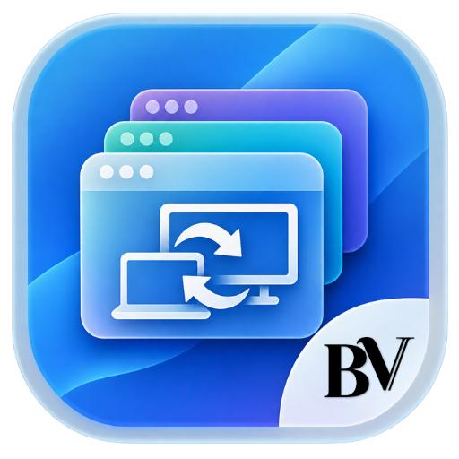
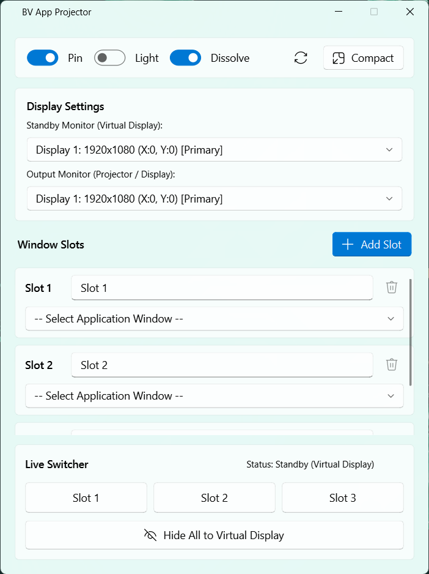
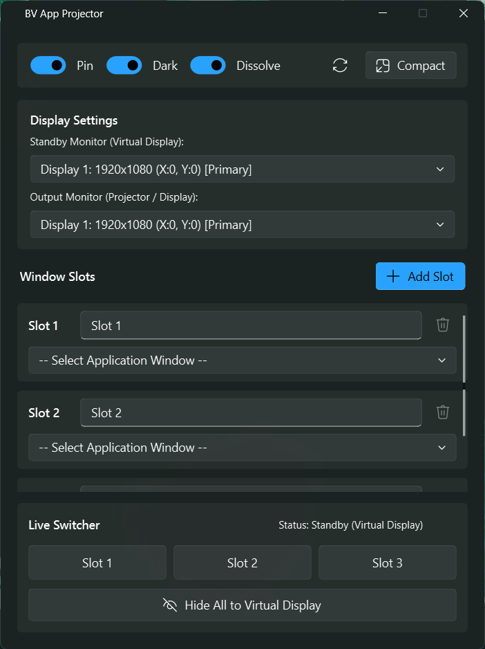
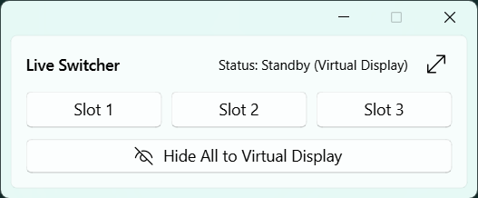

<div align="center">



# BV App Projector

**Switch what your audience sees with a single click.**
Move application windows between a standby screen and your projector, with smooth dissolve transitions.

[](../../releases/latest)


<br>



</div>

---

## Why BV App Projector?

Running a live event is stressful enough. Dragging windows between screens in front of an audience should not be part of it.

**BV App Projector** keeps your presentation, lyrics, videos, and other apps ready on a *standby* screen, and lets you send any of them to the *output* screen (your projector, LED wall, or TV) with one click. Nothing else on your control screen has to move.

It is a great fit for **worship services, conferences, concerts, classrooms, live streams, and any event** where you switch between several apps on a second display.

## Features

- **One-click Live Switcher**: send any window to the output screen instantly.
- **Smooth dissolve transition**: fade between windows, or choose a hard cut.
- **Standby and output monitors**: pick which screen holds waiting windows and which one your audience sees.
- **Custom slots**: assign any open window to a slot and give it a clear name. Add as many slots as you need.
- **Hide All**: send every window back to standby with one button.
- **Compact mode**: shrink the app into a tiny Live Switcher bar that stays out of your way, with a smooth morph animation.
- **Always on top**: pin the window above everything else.
- **Light and Dark themes**: starts in Light, remembers your choice.
- **Modern Windows 11 look**: Mica backdrop, native title bar, and your Windows accent color.
- **Automatic detection**: monitors and open windows are refreshed automatically, no restart needed.
- **Remembers your setup**: theme, monitors, slot names, window position, and size are restored on the next launch.

## Screenshots

<div align="center">

| Light | Dark |
|:---:|:---:|
|  |  |

| Compact mode |
|:---:|
|  |

</div>

## How it works

BV App Projector works with the extended desktop of Windows. A typical setup uses three displays:

```
  +----------------+     +----------------+     +----------------+
  |   Display 1    |     |   Display 2    |     |   Display 3    |
  |  Your control  |     |    Standby     |     |     Output     |
  |  screen (this  |     | (apps wait     |     | (projector /   |
  |  app lives     |     |  here)         |     |  LED wall)     |
  |  here)         |     |                |     |                |
  +----------------+     +----------------+     +----------------+
```

When you click a slot, that window moves to the **output** display and fills it. All the other slot windows go to the **standby** display. Your audience only ever sees what is on the output display.

> **Tip:** You do not need a third physical monitor for standby. An HDMI dummy plug or a virtual display driver works too.

## Download and install

Go to the [**Releases**](../../releases/latest) page and download one of these:

| File | Description |
|---|---|
| `BV-App-Projector-Setup-x.x.x.exe` | **Installer** (recommended). Installs to Program Files, adds a Start Menu shortcut, and an optional desktop shortcut. |
| `BV-App-Projector-x.x.x-portable.exe` | **Portable**. A single file. No installation, just run it. |

> **Windows SmartScreen warning?** This app is not code-signed yet, so Windows may show "Windows protected your PC". Click **More info**, then **Run anyway**. The full source code is in this repository for you to inspect or build yourself.

## Quick start

1. **Open BV App Projector.**
2. In **Display Settings**, choose your **Standby Monitor** and your **Output Monitor**.
3. In **Window Slots**, click the dropdown in each slot and select the application window you want to control. Rename the slot (for example, "Lyrics", "Video", or "Slides") so it is easy to recognize.
4. In the **Live Switcher** at the bottom, click a slot button. That window appears on the output screen, and the others wait on standby.
5. Click **Hide All to Virtual Display** to send everything back to standby.

### Controls

| Control | What it does |
|---|---|
| **Pin** | Keeps BV App Projector above all other windows. |
| **Light / Dark** | Switches the app theme. |
| **Dissolve / Cut** | Dissolve fades between windows. Cut switches instantly. |
| **Reset** (circular arrow) | Restores all settings to their defaults, after asking for confirmation. |
| **Compact** | Shrinks the app into a small Live Switcher bar. |
| **Expand** (arrow icon in compact mode) | Brings back the full window. |
| **Add Slot** | Adds another slot. The trash icon removes a slot (at least 3 are always kept). |

### Your settings

Settings are saved automatically when you close the app, in:

```
%APPDATA%\BVAppProjector\config.json
```

The installer's uninstaller will ask whether you also want to delete them.

## System requirements

| | Minimum | Recommended |
|---|---|---|
| **Operating system** | Windows 10 (version 2004, build 19041) or later, 64-bit | Windows 11 (22H2 or later) |
| **Displays** | 2 | 3 (control, standby, output) |
| **Memory** | 4 GB RAM | 8 GB RAM |
| **Disk space** | Less than 200 MB | |
| **Permissions** | Standard user (administrator rights are needed only to install into Program Files) | |

> The Mica backdrop and the full modern look need Windows 11 22H2 or later. On Windows 10 the app works, but some visual effects are not available.

## FAQ and troubleshooting

**A window I want is not in the dropdown.**
Make sure the application is open and visible. The list refreshes automatically every 1.5 seconds.

**My slots are empty after restarting the app.**
Slot names are remembered, but the chosen windows are not. Windows gives every window a new internal ID each time an app opens, so you need to pick the windows again for each session.

**A window will not move.**
If the other application runs as administrator, run BV App Projector as administrator too. Applications in exclusive full-screen mode may not respond either. Use windowed or borderless mode instead.

**The background looks plain or dark.**
The Mica effect requires Windows 11 22H2 or later, with *Transparency effects* turned on in *Settings > Personalization > Colors*.

**The dissolve looks different on some apps.**
Dissolve changes window opacity, and a few apps handle that differently. Switch to **Cut** for those.

## Build from source

You need **Windows 10/11** and **Python 3.14** (recommended).

1. Clone or download this repository, then open a terminal in its folder.
2. Install the dependencies:

   ```
   python -m pip install -r requirements.txt
   ```

3. Run the app:

   ```
   python switcher.py
   ```

### Build the portable `.exe`

```
python -m pip install pyinstaller pyinstaller-versionfile
python -m PyInstaller --onefile --windowed --noconfirm --name "BV App Projector" --icon=app_icon.ico --version-file version_info.txt --add-data "app_icon.png;." switcher.py
```

The result is in the `dist` folder.

### Build the installer

Install [Inno Setup](https://jrsoftware.org/isinfo.php), open `installer.iss`, adjust the file paths at the top to match your folders, and press **Ctrl + F9** to compile.

## Built with

- [Python](https://www.python.org/)
- [PyQt5](https://www.riverbankcomputing.com/software/pyqt/)
- [PyQt-Fluent-Widgets](https://github.com/zhiyiYo/PyQt-Fluent-Widgets)
- [pywin32](https://github.com/mhammond/pywin32)
- [darkdetect](https://github.com/albertosottile/darkdetect)
- [PyInstaller](https://pyinstaller.org/) and [Inno Setup](https://jrsoftware.org/isinfo.php) for packaging

## Contributing

Bug reports, ideas, and pull requests are very welcome. Please open an [issue](../../issues) to start a conversation.

## License

BV App Projector is free and open source software, released under the **GNU General Public License v3.0**. See the [LICENSE](LICENSE) file for details.

Third-party components remain under their own licenses.

## Credits

Developed by **JORD Andreas**.
Published by **BellaVoz Entertainment** ([bellavoz.id](https://www.bellavoz.id/)).

Copyright (c) 2026 BellaVoz Entertainment.
